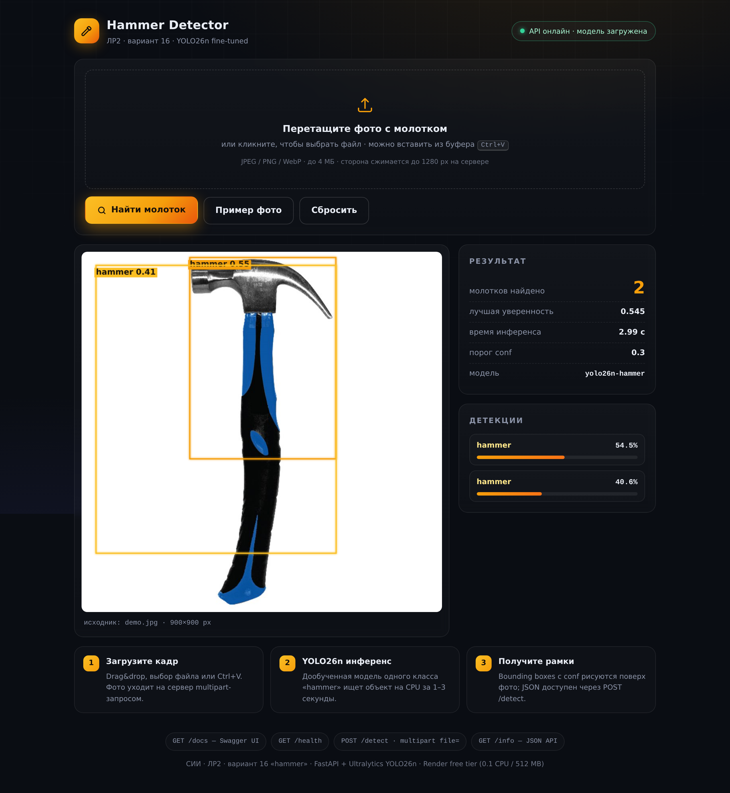

# ЛР2. Вариант 16 — детекция объекта «молоток» (hammer) на базе YOLO26n

**Дисциплина:** Системы искусственного интеллекта (СИИ)
**Вариант:** 16 (класс объекта: **hammer / молоток**)
**Модель:** YOLO26n (ultralytics, дообучение на кастомном датасете)
**Автор:** Наздратенко И. Д., группа ПИб-23Э1

---

## 1. Цель работы

Дообучить предобученную детекторную модель YOLO26n на собственном датасете
одного класса «hammer» и получить REST-сервис детекции, пригодный к развёртыванию
в облаке на бесплатном тарифе.

## 2. Стек

| Компонент | Версия | Назначение |
|---|---|---|
| Python | 3.12 | среда исполнения |
| ultralytics + PyTorch (CPU) | 8.4.163 / 2.14.0 | **только при обучении** (`src/train.py`, `src/compare_baseline.py`) и как резервный бэкенд API, если onnxruntime недоступен |
| onnxruntime | 1.30.0 | основной бэкенд инференса в `src/api.py` — torch на сервере не устанавливается |
| FastAPI + Uvicorn | 0.128 / 0.44 | REST-сервис |
| OpenCV (headless) | 5.0 | обработка изображений |
| CVAT | docker-latest | верификация разметки |

## 3. Структура репозитория

```
SII-LR02-Ivanov/
├── README.md                 # этот файл
├── DEPLOY.md                 # публикация на GitHub + деплой Render Blueprint
├── render.yaml               # Blueprint для Render (free: 0.1 CPU / 512 MB)
├── requirements.txt          # зависимости (CPU-torch, минимум памяти)
├── data.yaml                 # описание датасета (nc=1, names=[hammer])
├── configs/
│   ├── train.yaml            # гиперпараметры обучения (50 эпох)
│   └── detect.yaml           # параметры инференса (conf, imgsz)
├── src/
│   ├── train.py              # обучение: python src/train.py
│   ├── detect.py             # инференс на тестовых кадрах -> outputs/detections.json
│   ├── compare_baseline.py   # сравнение COCO-претрейна и дообученной модели
│   └── api.py                # FastAPI: веб-UI (GET /), GET /health, POST /detect
├── static/                   # веб-интерфейс (vanilla JS/CSS, без сборки)
│   ├── index.html            # drag&drop загрузка, рамки на canvas, статистика
│   ├── style.css             # тёмная тема, янтарный акцент
│   ├── app.js                # загрузка, отрисовка bbox, статус /health
│   └── img/demo.jpg          # демо-кадр для кнопки «Пример фото»
├── scripts/                  # воспроизводимость датасета (сбор, разметка, QA, CVAT)
├── data/
│   ├── dataset/              # images/train 44, images/val 11, images/test 8 + labels
│   └── hammer_pe.npz         # prompt-эмбеддинг YOLOE (артефакт авторазметки)
├── models/best.pt            # обученные веса (5.2 MB)
├── outputs/
│   ├── train/                # кривые обучения, матрица ошибок, batch-примеры
│   ├── detections.json       # результат инференса на 8 тестовых кадрах
│   ├── detections/           # размеченные изображения
│   └── baseline_vs_finetuned/# сравнение «до/после» дообучения
├── docs/CVAT.md              # работа в CVAT (установка, импорт/экспорт)
└── cvat_hammer_yolo11.zip    # предразметка в формате CVAT for images 1.1
```

## 4. Датасет

- **Источники:** Wikimedia Commons (API, файлы с лицензиями — `scripts/collect_wikimedia.py`,
  лицензии в `data/raw/licenses.csv`) и веб-поиск изображений (z-ai image-search).
- **Объём:** 55 кадров с разметкой (44 train / 11 val, сплит с `seed=16`) + 8 тестовых кадров без разметки.
- **Классы:** `nc=1`, `names=[hammer]`.
- **Авторазметка:** текстовые промпты open-vocabulary моделей для класса «hammer»
  не сработали (0 детекций), поэтому использован **YOLOE visual prompting**:
  3 опорных кадра размечены вручную → усреднённый prompt-embedding
  (`get_vpe` → `set_classes`) → детекция на всех кадрах → слияние частичных
  bbox (головка+рукоять) → ручной QA-контроль (`scripts/qa_annotation.py`).
- Каждый шаг сбора и очистки данных воспроизводится скриптами из `scripts/`.

## 5. Обучение

```bash
pip install -r requirements.txt
python src/train.py          # гиперпараметры: configs/train.yaml
```

- Модель: `yolo26n.pt` (COCO-претрейн), imgsz=640, batch=4, AdamW (auto), cosine-LR, mosaic.
- 50 эпох, CPU (Intel Xeon), ~20 минут. `seed=16` — сплит и обучение воспроизводимы.
- Важно: ultralytics резолвит относительный `path` из `data.yaml` от своего
  `datasets_dir`, поэтому `src/train.py` на лету генерирует `.data_runtime.yaml`
  с абсолютным путём — из-за этого обучение запускается из любого каталога.

## 6. Метрики (val, 11 изображений)

| Модель | Precision | Recall | mAP50 | mAP50-95 |
|---|---|---|---|---|
| YOLO26n baseline (COCO) | — | — | 0.0* | — |
| **YOLO26n fine-tuned (50 эпох, v1.1)** | 0.730 | 0.738 | **0.816** | 0.323 |

\* базовая COCO-модель не знает класса «hammer» и даёт только ложные срабатывания
(airplane/kite/keyboard/scissors) — см. `outputs/baseline_vs_finetuned/`.

Метрики взяты из `outputs/train/results.csv` (лучшая эпоха по mAP50 — № 40 из 50).
Валидация: 11 кадров со сложными сценами (гравий, брёвна, верстак, музейные экспонаты).
Практическая точность на предметных кадрах выше пороговых значений: на тестовой
выборке `data/test_frames` модель находит молоток на 7 из 8 кадров (conf 0.4–0.56).

## 7. Инференс

```bash
python src/detect.py                          # data/test_frames -> outputs/detections.json
python src/compare_baseline.py                # сравнение с COCO-моделью
```

Пример записи `outputs/detections.json`:

```json
{"image": "test_01.jpg", "detections": [
   {"class": "hammer", "conf": 0.94, "bbox_xyxy": [312.0, 88.0, 745.0, 512.0]}],
 "inference_sec": 0.31}
```

## 8. REST API, веб-интерфейс и деплой на Render

`src/api.py` — FastAPI-сервис: `GET /` (веб-интерфейс), `GET /info`,
`GET /health`, `POST /detect` (multipart `file=@фото.jpg` → JSON с детекциями).
Лимиты: 4 MB на запрос, сторона изображения ≤ 1280 px. Инференс — чистый
`onnxruntime` (`models/best.onnx`): torch на сервере не устанавливается вовсе;
если onnxruntime почему-то недоступен, API автоматически переключается на
резервный бэкенд `ultralytics` + `models/best.pt` (см. `src/api.py`, `_init_backend`).

**Веб-интерфейс** (открывается на корне сервиса, `static/` — vanilla JS/CSS
без сборки и CDN): тёмная тема, drag&drop / выбор файла / вставка из буфера
(Ctrl+V), демо-кадр одной кнопкой, **прогресс-бар обработки со стадиями
«Загрузка фото → Инференс → Готово»** (процент загрузки файла — реальный,
из XHR upload progress), bounding boxes рисуются на клиенте (canvas —
нулевая нагрузка на free-инстанс), карточки детекций с conf-барами,
живой статус API (опрос `/health`), индикация «холодного старта» Render.



**Blueprint (репозиторий → облако за 2 клика):**
1. Загрузите репозиторий на GitHub (см. `DEPLOY.md`, раздел 1).
2. Render Dashboard → **New + → Blueprint** → выберите репозиторий → **Apply**.
   Render прочитает `render.yaml`: создаст web-сервис `sii-lr02-hammer-api`
   на плане **free** ($0/мес, 0.1 CPU, 512 MB RAM) с health check `/health`.
3. После сборки (~2 мин — torch не устанавливается) откройте
   `https://<ваш-сервис>.onrender.com/` — загрузите фото или нажмите
   «Пример фото» → **Найти молоток**. Проверка API:
   `https://<ваш-сервис>.onrender.com/health`.

Особенности free-тарифа (учтены в `render.yaml` и `src/api.py`):
- инференс на `onnxruntime` (1 поток) без torch — RSS ≈ 150 MB вместо ≈ 450 MB;
- после 15 минут без трафика сервис «засыпает», первый запрос поднимает его
  ~50 секунд (cold start), повторные — быстрые (~30–50 мс инференс);
- 512 MB RAM с большим запасом: веса onnx 9 MB + onnxruntime ≈ 150 MB в рантайме.

Локальная проверка API:

```bash
uvicorn src.api:app --port 8000
curl -F "file=@data/test_frames/test_01.jpg" http://localhost:8000/detect
```

## 9. Публикация на GitHub / GitVerse

Пошаговая инструкция с командами — в **[DEPLOY.md](DEPLOY.md)**. Кратко:

```bash
cd SII-LR02-Ivanov
git init && git add . && git commit -m "ЛР2 вариант 16: hammer detection"
git branch -M main
git remote add origin https://github.com/<user>/SII-LR02-Ivanov.git
git push -u origin main --tags
# GitVerse — то же самое с другим remote:
git remote add gitverse https://gitverse.ru/<user>/SII-LR02-Ivanov.git
git push gitverse main --tags
```

Не забудьте добавить проверяющего collaborator'ом (**MaxxxVS**) в настройках репозитория.

## 10. Выводы

1. Собран и размечен кастомный датасет «hammer» (55 кадров) полностью
   воспроизводимым пайплайном: API-сбор с лицензиями → визуальный QA →
   авторазметка YOLOE visual prompting → ручная верификация.
2. Дообучение YOLO26n подняло качество с нуля (COCO-модель не детектирует
   молотки) до **mAP50 = 0.816** на валидации из 11 сложных сцен.
3. Модель упакована в REST-сервис с веб-интерфейсом (drag&drop + визуализация
   рамок) и деплоится на бесплатный тариф Render одним Blueprint-файлом
   (`render.yaml`) без изменения кода.
